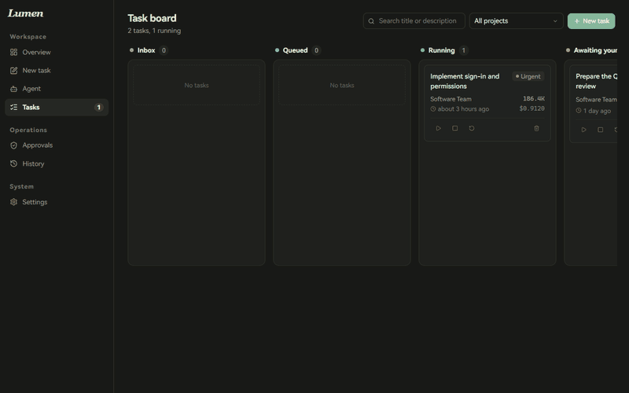
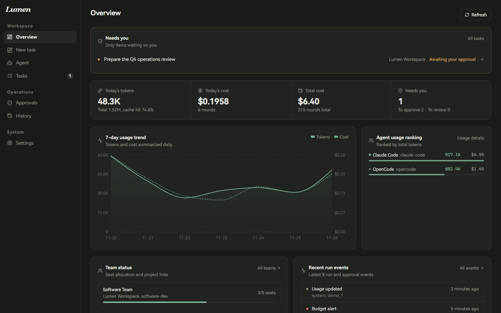
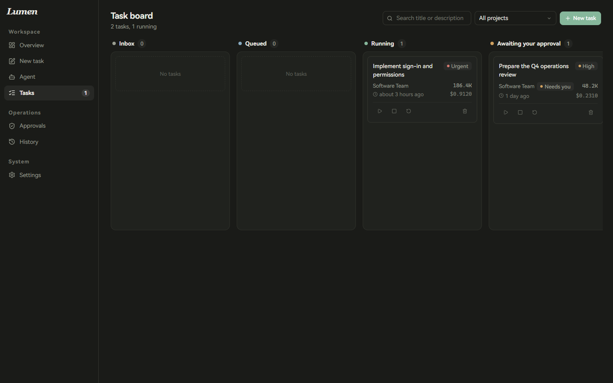
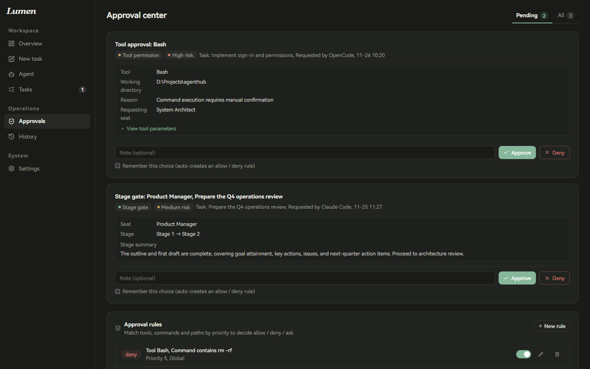

# Lumen

**English** | [中文](README.zh-CN.md)

Lumen is a local-first multi-agent workbench for Windows. It turns projects, teams, seats, tasks, runs, approvals, budgets, and Git change review into a traceable local pipeline, so CLI agents such as Claude Code and OpenCode can collaborate within explicit authorization and cost boundaries.

Current version: `0.1.3`, SQLite schema `v8`. The project is still early-stage: core capabilities are complete, but cross-platform support and frontend automation are not fully closed yet. Auto-update has been verified end to end on Windows (`0.1.0 → 0.1.1 → 0.1.2`). Read "Known limitations" and "Handover notes" before taking over.

Install from [Releases](https://github.com/MaJ2cxyK/Lumen/releases/latest). MIT licensed.

## Demo

Create a task → pick a team → dispatch → approve → review changes, in about 10 seconds:



## Screenshots



<details>
<summary>More: task board and approval center</summary>





</details>

> Screenshots and the demo use the app's built-in demo data; paths, tasks, and usage figures are fictional.

## Tech stack

| Layer | Choice |
|---|---|
| Desktop shell | Tauri 2 (Rust + WebView2) |
| Frontend | React 19, TypeScript, Vite 8, Tailwind CSS 4, Zustand, React Router |
| Backend | Rust 2021, tokio, rusqlite (bundled SQLite, WAL) |
| Charts | Recharts |
| Tests | Rust unit/integration tests, Vitest, Playwright Core route audit |
| Distribution | Windows NSIS; optional Authenticode signing and Tauri Updater |

## Quick start

### Requirements

- Windows 10/11 x64
- Node.js 22+ and npm
- Rust stable and MSVC Build Tools
- WebView2 Runtime
- Git (required for isolated worktrees, change review, and PR features)
- Optional: Chrome or Edge (used by `npm run ui:clip-audit`)
- Optional: `gh` CLI (used by "Create PR")

### Run

```powershell
npm ci
npm run tauri dev
```

`npm run tauri dev` starts Vite and then opens the Tauri window. To debug the frontend only, run `npm run dev`; the browser preview uses the local mock data in `src/lib/mock.ts`.

## Common commands

| Command | Purpose |
|---|---|
| `npm run dev` | Start Vite only; browser preview uses mock data |
| `npm run tauri dev` | Start the full desktop app |
| `npm run build` | TypeScript check + production frontend build |
| `npm run typecheck` | Run `tsc --noEmit` only |
| `npm test` | Run frontend Vitest tests |
| `npm run test:watch` | Run frontend tests in watch mode |
| `npm run ui:clip-audit` | Shadow-clipping audit over 13 routes in both languages |
| `npm run gate:ui` | `npm run build` + route audit |
| `npm run test:e2e` | Core workflow smoke test: create, dispatch, approve, review |
| `cargo fmt --manifest-path src-tauri/Cargo.toml -- --check` | Rust format check |
| `cargo clippy --manifest-path src-tauri/Cargo.toml --all-targets` | Rust lints |
| `cargo test --manifest-path src-tauri/Cargo.toml --all-targets` | Rust unit and integration tests |
| `npm run tauri build -- --bundles nsis` | Build the Windows NSIS installer |
| `npm run build:signed` | Build NSIS with the signing config |
| `npm run release:update` | Build updater artifacts and `latest.json` |

On the first local Rust command, make sure `%USERPROFILE%\.cargo\bin` is on `PATH`.

## Architecture

```text
React pages / components (src/pages, src/components)
        │ invoke / listen
        ▼
Tauri commands (src-tauri/src/commands/, ~100 commands)
        │
        ├── SQLite (db.rs, 21 tables, WAL, versioned migrations)
        ├── orchestrator/  stage pipeline: context, prompt, gates, transitions
        │        └── runtime/  run session: launch plan, stream-json, usage, events
        │                ├── approval.rs  tool approval gateway and rules
        │                ├── llm_proxy.rs  local model proxy, per-request budget
        │                └── sandbox/  Job Object / AppContainer
        ├── review.rs / snapshot.rs / worktree.rs  Git isolation, review, snapshots
        ├── budget.rs / usage.rs  budget reservations, settlement, aggregation
        ├── backup.rs  database backup, rotation, restore
        └── providers.rs / extensions.rs / detect.rs  CLI and config injection
```

### Code map

| Path | Responsibility |
|---|---|
| `src/pages/` | Dashboard, projects, tasks, approvals, history, usage, budgets, settings |
| `src/lib/api.ts` | Unified Tauri invoke / event wrapper |
| `src/lib/mock.ts` | Backend mock for browser preview (~2,400 lines) |
| `src/lib/taskLifecycle.ts` | Persisted task status, derived board stage, attention rules, and shared action guards |
| `src-tauri/src/commands/` | Domain command modules for tasks, teams, projects, runs, approvals, providers, data, usage, and system |
| `src-tauri/src/orchestrator/` | Dispatch and resume entry points; `pipeline.rs`, `context.rs`, `gate.rs` |
| `src-tauri/src/runtime/` | Run sessions: `session.rs`, `launch.rs`, `stream.rs`, `store.rs`, `events.rs`, `policy.rs` |
| `src-tauri/src/approval.rs` | Hook approvals, approval rules, state consistency |
| `src-tauri/src/review.rs` | Git diff, revert, commit, apply, branch, PR, snapshot rollback |
| `src-tauri/src/db.rs` | Schema, migrations, event sequence, messages, cleanup |
| `src-tauri/src/sandbox/` | Windows AppContainer / named pipes / ACL |

`src-tauri/src/commands/` is split by domain; keep changes inside the owning module. `TaskDetail.tsx` and `mock.ts` remain the largest frontend files.

## Core flow

1. Create a project with a local directory, type, and description; the project card detects whether it is a Git repository.
2. Create a team from a template; seats get responsibilities and an order.
3. Assign agents to seats; tasks can use per-step confirmation or in-task automatic authorization.
4. Create a task with optional subtasks, dependencies, attachments, acceptance checklist, and an isolated Git worktree.
5. After dispatch, seats run in order; stage gates pause for human confirmation.
6. Claude Code approves tool calls one by one through the local hook gateway; other CLIs request authorization before running.
7. Every run records `runs`, `usage_events`, `events`, `tool_calls`, and transcript entries; budgets warn or block in real time.
8. When an isolated task finishes, it enters "Changes review": view the diff, revert, commit, apply to the project, create a branch, or open a PR.

## Security and cost boundaries

- **Approvals default to strict**: unknown tools ask by default; dangerous-command checks run before "remember" rules; commands with shell composition only match exactly.
- **Approval credentials stay in memory**: the Claude hook token exists only in memory, is injected via environment variables, never written to `settings.json` or passed on the command line.
- **Provider keys**: encrypted with Windows DPAPI; when the proxy is enabled, child processes only receive a one-time token and the local proxy address.
- **Process isolation**: Job Objects limit memory/process count and kill the tree on cancel by default. AppContainer file isolation is enabled by default but only takes effect when a provider is configured and the model proxy is on; otherwise Lumen falls back explicitly and records the reason in run events. Git workspaces (a `.git` in the project directory or any ancestor) always fall back to process isolation because Git for Windows requires `NUL`; this is a deliberate product trade-off. Non-Git projects can still use AppContainer. Run history shows the "process isolation" marker and reason. Sandbox ACLs for project/CLI/HOME are reused while enabled and reclaimed when disabled.
- **Budgets**: token/USD, global/project/team/agent/task, daily/monthly/lifetime; the local proxy enforces per-request admission and lowers `max_tokens`.
- **Data export**: JSON exports clear provider keys and redact sensitive fields in `env`/`config`.

To report a vulnerability privately, follow [SECURITY.md](SECURITY.md). Do not open a public issue for security problems.

## Data directory

The default data directory is `%APPDATA%\Lumen`. The legacy `%APPDATA%\AgentHub` is migrated on first launch.

| Path | Contents |
|---|---|
| `lumen.db` | Main database (WAL) |
| `config.json` | App settings, written atomically |
| `sessions/` | Per-run temporary settings, host config, intermediate files |
| `logs/` | Application logs |
| `artifacts/` | Task artifacts |
| `extensions/` | MCP / Hooks / Skills / plugin runtime material |
| `backups/` | Database backups, 7 kept by default |
| `snapshots/` | Pre-run patch snapshots for non-isolated runs, 20 kept by default |
| `worktrees/` | Git worktrees for isolated tasks; never deleted automatically |
| `sandbox-home/` | HOME/TEMP for CLIs inside AppContainer; kept when the sandbox is off |
| `sandbox-acl/` | AppContainer ACL reclaim markers |

Transcripts are kept for 90 days by default and can be adjusted in settings. Backups rotate at startup; if there has been no backup in the last 24 hours, one is created automatically.

## Testing and acceptance

Run at least:

```powershell
npm test
npm run build
npm run ui:clip-audit
npm run test:e2e
cargo fmt --manifest-path src-tauri/Cargo.toml -- --check
cargo clippy --manifest-path src-tauri/Cargo.toml --all-targets -- -D warnings
cargo test --manifest-path src-tauri/Cargo.toml --all-targets
```

`ui:clip-audit` starts a local preview and a real headless Chrome/Edge, checks 13 routes and the new-task dialog in both Chinese and English, and verifies that shadows are not clipped and pages have content. CI uses the Edge bundled with the Windows runner.

On Windows you can also run the real sandbox probe:

```powershell
.\src-tauri\target\debug\lumen-app.exe --sandbox-probe $env:TEMP\lumen-sandbox-probe
```

`--sandbox-exec <spec.json>` is a maintainer diagnostic entry point: it runs a given CLI (for example `claude --version`) inside AppContainer in a real project directory without granting network access, and can reclaim the profile/ACL afterwards. It is not part of the product UI and does not replace regular E2E.

The diagnostic config can set `mockLlm: true` and `promptNonce` to start a loopback-only Anthropic-compatible fake upstream. It verifies through the same container relay that Claude `-p` can send a prompt, consume SSE, and echo a fixed answer, without touching the public internet or simulating real model capability. The report's `mockLlm` only records path, nonce hits, whether auth headers exist, and the streaming flag; it does not record request bodies or tokens.

Current test focus:

- Rust: budget admission/settlement, approval policy and state consistency, migrations, backup rotation and redaction, LLM proxy streaming usage, Git review, named pipes.
- Frontend: task-stage derivation, CLI visibility preferences, 13-route browser audit, and core workflow smoke test.

## CI and release

`.github/workflows/ci.yml` runs:

- Frontend: `npm ci` → `npm test` → `npm run build` → route audit → core workflow smoke test.
- Backend: `cargo fmt --check` → `cargo clippy --all-targets -- -D warnings` → `cargo test --all-targets`.
- Public repository gate: the `hygiene` job fetches the full Git history and runs `npm run guard:public`, blocking credentials, private keys, internal documents, local data, and release artifacts. See [`AGENTS.md`](AGENTS.md) for the exact boundary.

`.github/workflows/release.yml` builds the signed installer, updater artifacts, and `latest.json` when a `v*` tag is pushed. Configure these secrets:

- `WINDOWS_CERT_PFX_BASE64`, `WINDOWS_CERT_PFX_PASSWORD`
- `TAURI_SIGNING_PRIVATE_KEY`, `TAURI_SIGNING_PRIVATE_KEY_PASSWORD`
- `TAURI_SIGNING_PUBLIC_KEY`

The optional `UPDATE_BASE_URL` variable sets the update download prefix.

> The base `src-tauri/tauri.conf.json` keeps the updater endpoint/pubkey empty; `src-tauri/tauri.release.conf.json` still holds a placeholder address and placeholder public key. CI overrides both via `scripts/prepare-publish-config.mjs` using `TAURI_SIGNING_PUBLIC_KEY` and `UPDATE_BASE_URL`, writing `tauri.publish.conf.json`. Updater signing secrets are configured; the Windows "check → download → verify signature → install → restart" flow was verified on 2026-11-26 through `0.1.0 → 0.1.1` and `0.1.1 → 0.1.2`. The local `scripts/release.ps1` still needs the public key filled into the release config.

## Code signing policy

> Status: Lumen plans to apply for free open-source code signing from the SignPath Foundation; installers stay unsigned until approved.
>
> Reapplication threshold: the GitHub repository reaches 50 stars or the installer reaches 500 cumulative downloads, with at least one external publication or community mention and no security incident in the meantime. We will not resubmit before the threshold is met.

- **Signing provider (planned)**: Free code signing provided by SignPath.io, certificate by SignPath Foundation.
- **Project roles**: Authors / Reviewers / Approvers are all [@MaJ2cxyK](https://github.com/MaJ2cxyK), currently the only maintainer.
- **Build provenance**: Windows installers are built only by this repository's GitHub Actions; once approved, only those artifacts are submitted to SignPath. Local manual builds are never signed.
- **Signing scope**: only `Lumen_<version>_x64-setup.exe` (Windows x64 NSIS installer) and the matching updater artifacts; no third-party binaries or upstream components.
- **Version metadata**: the installer ProductName is always `Lumen`; ProductVersion and FileVersion use the same version from `src-tauri/tauri.conf.json` for every release.
- **Privacy**: This program will not transfer any information to other networked systems unless specifically requested by the user or the person installing or operating it. Lumen runs locally and sends no telemetry; prompts and necessary context go to the user's configured provider only when the user starts a task.

## Known limitations

- **Windows only**: NSIS, Job Objects, AppContainer, `explorer`, `taskkill` and similar implementations are Windows-specific.
- **Uneven adapter depth**: 26 CLI detection specs are built in, but only Claude Code has structured stream-json, tool approvals, usage, and resumable runs. OpenCode binds an OpenAI-compatible provider through temporary run-scoped config and passes `-m lumen/<model>` explicitly (it does not read `OPENAI_MODEL`), but has no tool-level approvals, structured usage, or resume; the other 24 use generic pipes. `pty` is a legacy name; the project has no real PTY dependency.
- **Linear stage orchestration**: no worker-slot scheduling, mid-run steering, outbox, parallel branches/DAG, or scheduled jobs.
- **Search uses SQL `LIKE`**: history full-text search does not use FTS5 yet.
- **Sandbox depends on the proxy**: AppContainer is on by default, but its HOME is isolated from the host, so CLI login state is not carried over; without a configured provider or with the model proxy off, Lumen falls back to process isolation. Git workspaces always fall back because Git for Windows requires `NUL`; this is expected and not a blocker. Requiring strict AppContainer for Git tasks would need an architectural change (for example a host-side Git proxy or lifting the `NUL` restriction), not a rule tweak. Containers grant no network access by default, only a relay loop to the local gateway/proxy. The first sandbox run on a large project walks the tree to grant ACLs; later runs reuse them, and disabling the sandbox reclaims them.
- **Budget hard stops have limits**: with the Lumen provider proxy, requests can be blocked per request; with CLI login state or the proxy off, Lumen can only terminate after the fact via the watchdog.
- **Auto-update**: verified on Windows through `0.1.0 → 0.1.1 → 0.1.2` (GitHub Releases + `latest.json`); other platforms are untested.
- **Frontend automation is still thin**: stage-logic unit tests, route audit, and one core-workflow smoke test exist, but there are no broad component interaction tests or full desktop E2E.
- **Git history was rewritten**: early commits were squashed when internal material was removed, so blame before `v0.1.0` is discontinuous; prefer small commits going forward.
- **License**: MIT, see `LICENSE`; third-party dependencies keep their own licenses.

## Handover notes

1. Get "Quick start" and "Testing and acceptance" green before changing code.
2. Read command boundaries in `commands/`, the task state machine in `orchestrator/pipeline.rs`, and process lifetimes in `runtime/session.rs`.
3. For changes involving approvals, budgets, processes, or data deletion, check transactions, terminal-state cleanup, and failure paths first.
4. After UI changes run `npm run gate:ui`; after Rust changes run clippy (with `-D warnings`) and the full test suite.

## Contributing

Read [CONTRIBUTING.md](CONTRIBUTING.md) before opening a pull request. Security reports go through [SECURITY.md](SECURITY.md), and user-visible release history is tracked in [CHANGELOG.md](CHANGELOG.md).

## License

MIT, see [LICENSE](LICENSE).

## Third-party notices

Lumen renders self-drawn monochrome lettermarks for the CLI tools it can launch;
it ships no third-party logo artwork or brand colors. Product names and
trademarks belong to their owners and identify compatible tools only, without
implying endorsement or affiliation. The projects that informed Lumen's design,
their licenses, and the dependency-licensing policy are listed in
[THIRD_PARTY_NOTICES.md](THIRD_PARTY_NOTICES.md).
