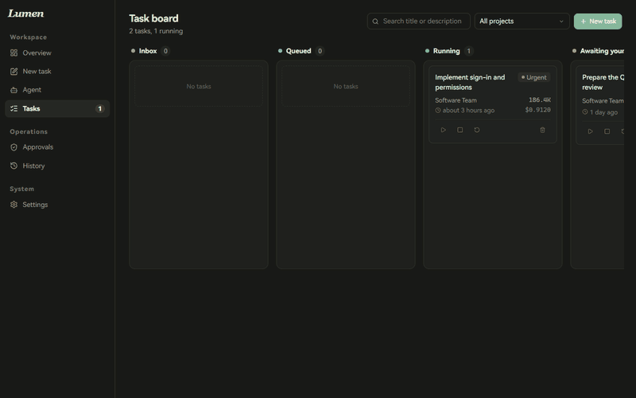
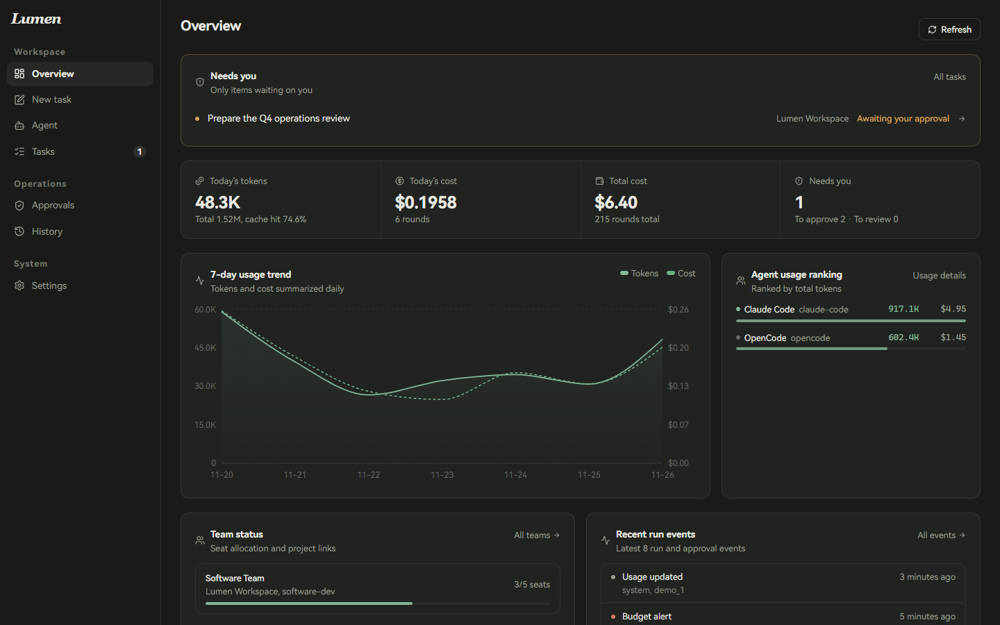
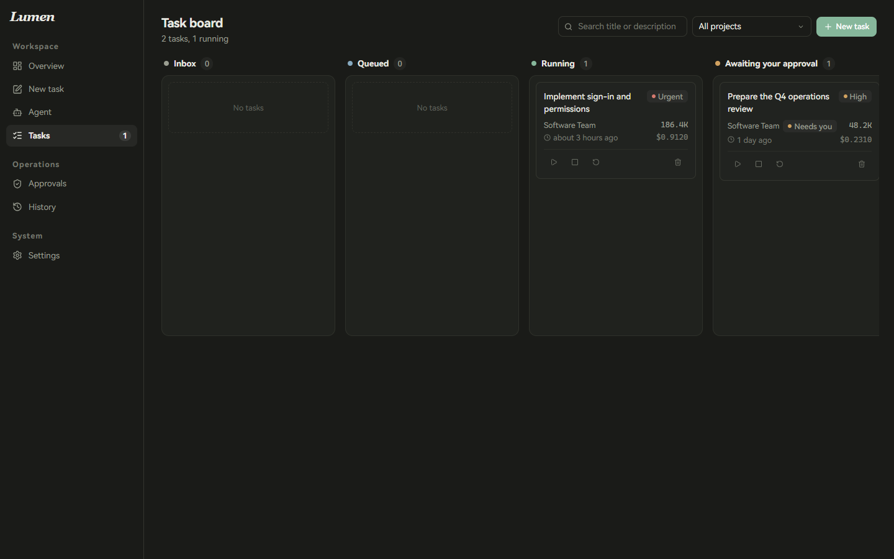
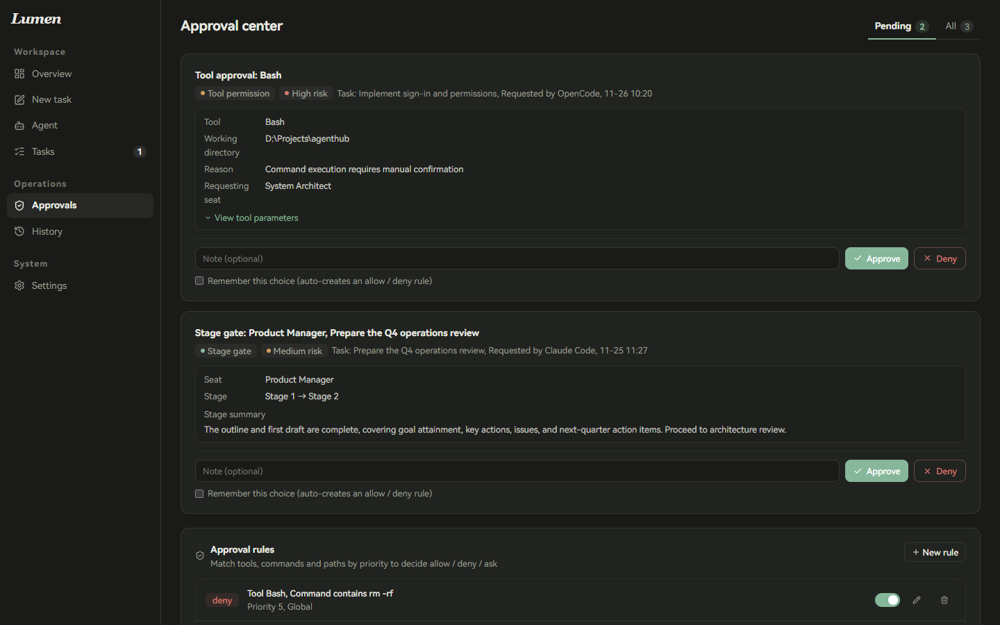

# Lumen

[English](README.md) | **中文**

Lumen 是一个面向 Windows 的本地多 Agent 协同工作台。它把项目、团队、席位、任务、运行、审批、预算和 Git 变更审阅组织成一条可追踪的本地流水线，让 Claude Code、OpenCode 等 CLI Agent 在明确的授权和成本边界内协作。

> **Lumen** — a local-first multi-agent workbench for Windows. It orchestrates CLI coding agents (Claude Code, OpenCode, and more) across projects, teams, tasks, approvals, budgets, and Git review, with AppContainer/Job Object isolation and explicit cost boundaries. Install from [Releases](https://github.com/MaJ2cxyK/Lumen/releases/latest). MIT licensed.

当前版本：`0.1.3`，SQLite schema `v8`。项目仍处于早期阶段：核心能力完整，但跨平台和前端自动化测试尚未完全收口；Windows 上的自动更新已完成 `0.1.0 → 0.1.1 → 0.1.2` 连续实测。接手前请先阅读本文的“已知边界”和“接手提示”。

## 演示

建任务 → 选择团队 → 派发 → 审批 → 变更审查，全流程约 10 秒：



## 界面预览



<details>
<summary>更多界面：任务看板与审批中心</summary>





</details>

> 截图使用应用内置演示数据，路径、任务与用量均为虚构。

## 技术栈

| 层 | 选型 |
|---|---|
| 桌面壳 | Tauri 2（Rust + WebView2） |
| 前端 | React 19、TypeScript、Vite 8、Tailwind CSS 4、Zustand、React Router |
| 后端 | Rust 2021、tokio、rusqlite（bundled SQLite，WAL） |
| 图表 | Recharts |
| 测试 | Rust 单元/集成测试、Vitest、Playwright Core 路由巡检 |
| 分发 | Windows NSIS；可选代码签名与 Tauri Updater |

## 快速开始

### 环境要求

- Windows 10/11 x64
- Node.js 22+ 与 npm
- Rust stable 与 MSVC Build Tools
- WebView2 Runtime
- Git（隔离工作区、变更审阅和 PR 功能依赖）
- 可选：Chrome 或 Edge（`npm run ui:clip-audit` 使用）
- 可选：`gh` CLI（“创建 PR”功能使用）

### 启动

```powershell
npm ci
npm run tauri dev
```

`npm run tauri dev` 会先启动 Vite，再拉起 Tauri 窗口。仅调试前端时可以执行 `npm run dev`，浏览器预览会使用 `src/lib/mock.ts` 的本地模拟数据。

## 常用命令

| 命令 | 用途 |
|---|---|
| `npm run dev` | 仅启动 Vite，浏览器使用 mock 数据 |
| `npm run tauri dev` | 启动完整桌面应用 |
| `npm run build` | TypeScript 检查 + 前端生产构建 |
| `npm run typecheck` | 仅执行 `tsc --noEmit` |
| `npm test` | 运行前端 Vitest 测试 |
| `npm run test:watch` | 监听模式运行前端测试 |
| `npm run ui:clip-audit` | 对 `dist` 做 13 路由 + 双语的阴影裁切巡检 |
| `npm run gate:ui` | `npm run build` + 路由巡检 |
| `npm run test:e2e` | 核心流程冒烟：新建、派发、审批、变更审查 |
| `cargo fmt --manifest-path src-tauri/Cargo.toml -- --check` | Rust 格式检查 |
| `cargo clippy --manifest-path src-tauri/Cargo.toml --all-targets` | Rust 静态检查 |
| `cargo test --manifest-path src-tauri/Cargo.toml --all-targets` | Rust 单元与集成测试 |
| `npm run tauri build -- --bundles nsis` | 构建 Windows NSIS 安装包 |
| `npm run build:signed` | 使用签名配置构建 NSIS |
| `npm run release:update` | 构建并生成 updater 产物与 `latest.json` |

首次在本机执行 Rust 命令时，确保 `%USERPROFILE%\.cargo\bin` 在 `PATH` 中。

## 架构

```text
React 页面 / 组件（src/pages、src/components）
        │ invoke / listen
        ▼
Tauri commands（src-tauri/src/commands.rs，约 100 个命令）
        │
        ├── SQLite（db.rs，21 张表，WAL，版本化迁移）
        ├── orchestrator.rs  阶段流水线、门禁、任务状态推进
        │        └── runtime.rs  子进程启动、流式输出、用量采集
        │                ├── approval.rs  工具审批网关与规则
        │                ├── llm_proxy.rs  本地模型代理、请求级预算
        │                └── sandbox/  Job Object / AppContainer
        ├── review.rs / snapshot.rs / worktree.rs  Git 隔离、审阅、快照
        ├── budget.rs / usage.rs  预算预留、结算、聚合
        ├── backup.rs  数据库备份、轮转、恢复
        └── providers.rs / extensions.rs / detect.rs  CLI 与配置注入
```

### 代码地图

| 路径 | 职责 |
|---|---|
| `src/pages/` | 总览、项目、任务、审批、历史、用量、预算、设置等页面 |
| `src/lib/api.ts` | Tauri invoke / event 的统一封装 |
| `src/lib/mock.ts` | 浏览器预览用的后端模拟，约 2400 行 |
| `src/lib/taskStage.ts` | “任务阶段 / 在等谁 / 是否需要你”的派生规则 |
| `src-tauri/src/commands.rs` | Tauri 命令入口与大部分 SQL 编排 |
| `src-tauri/src/orchestrator.rs` | 团队席位顺序、阶段门禁、派发与恢复 |
| `src-tauri/src/runtime.rs` | CLI 子进程、stream-json、用量、取消与超时 |
| `src-tauri/src/approval.rs` | Hook 审批、审批规则、状态一致性 |
| `src-tauri/src/review.rs` | Git diff、还原、提交、应用、分支、PR、快照回滚 |
| `src-tauri/src/db.rs` | schema、迁移、事件序号、消息与清理 |
| `src-tauri/src/sandbox/` | Windows AppContainer / 命名管道 / ACL |

`commands.rs`、`TaskDetail.tsx`、`mock.ts` 是当前最大的三个单体文件，修改时尽量只做局部改动。

## 核心流程

1. 创建项目，填写本地目录、类型与描述；项目卡片会检测是否为 Git 仓库。
2. 基于模板创建团队，生成带职责与顺序的席位。
3. 为席位指派 Agent；可为任务选择“逐次确认”或“任务内自动”授权。
4. 创建任务，可选子任务、依赖、附件、验收清单和独立 Git worktree。
5. 派发后按席位顺序执行；阶段门禁会暂停等待人工确认。
6. Claude Code 通过本地 Hook 网关逐次审批工具调用；其他 CLI 在运行前申请授权。
7. 每次运行落 `runs`、`usage_events`、`events`、`tool_calls` 与 transcript；预算实时预警或拦截。
8. 隔离任务完成后进入“变更审查”：查看 diff、还原、提交、应用到项目、建分支或生成 PR。

## 安全与成本边界

- **审批默认收紧**：未知工具默认询问；危险命令检查先于“记住”规则；带组合符的命令只接受精确匹配。
- **审批凭证不落盘**：Claude Hook token 只存在内存，经环境变量注入，不写入 `settings.json`，也不进入命令行。
- **供应商密钥**：使用 Windows DPAPI 加密；开启代理时，子进程只拿到一次性令牌和本地代理地址。
- **进程隔离**：默认 Job Object 限制内存/进程数并在取消时终止进程树；AppContainer 文件级隔离默认开启，仅在已配置供应商且模型代理开启时实际生效，否则显式回退并在运行事件中记录原因。Git 工作区（项目目录或任意祖先含 `.git`）会因 Git for Windows 依赖 `NUL` 而统一提前回退到进程隔离，这是明确的产品取舍；非 Git 项目仍可使用 AppContainer。运行历史会显示“进程隔离”标记及原因。沙箱开启期间项目/CLI/HOME 的 ACL 复用，关闭沙箱时统一回收。
- **预算**：支持 token / 美元、全局 / 项目 / 团队 / Agent / 任务、日 / 月 / 终身；本地代理做请求级准入和 `max_tokens` 下调。
- **数据导出**：导出 JSON 时会清空 provider 密钥并对 `env` / `config` 中的敏感字段脱敏。

漏洞请通过 [SECURITY.md](SECURITY.md) 的 GitHub 私有漏洞报告入口提交，不要开公开 Issue。

## 数据目录

默认数据目录为 `%APPDATA%\Lumen`。旧版本 `%APPDATA%\AgentHub` 会在首次启动时迁移。

| 路径 | 内容 |
|---|---|
| `lumen.db` | 主数据库（WAL） |
| `config.json` | 应用设置，原子写入 |
| `sessions/` | 每次运行的临时 settings、host 配置与中间文件 |
| `logs/` | 应用日志 |
| `artifacts/` | 任务产物 |
| `extensions/` | MCP / Hooks / Skills / 插件运行期物料 |
| `backups/` | 数据库备份，默认保留 7 份 |
| `snapshots/` | 非隔离运行的运行前补丁快照，默认保留 20 份 |
| `worktrees/` | 隔离任务的 Git worktree，不会自动删除 |
| `sandbox-home/` | AppContainer 内 CLI 的 HOME/TEMP，关闭沙箱时保留 |
| `sandbox-acl/` | AppContainer ACL 回收 marker |

Transcript 默认保留 90 天，可在设置中调整。备份在启动时轮转，最近 24 小时无备份会自动生成一份。

## 测试与验收

提交前至少执行：

```powershell
npm test
npm run build
npm run ui:clip-audit
npm run test:e2e
cargo fmt --manifest-path src-tauri/Cargo.toml -- --check
cargo clippy --manifest-path src-tauri/Cargo.toml --all-targets -- -D warnings
cargo test --manifest-path src-tauri/Cargo.toml --all-targets
```

`ui:clip-audit` 会启动本地 preview 和真实的无头 Chrome/Edge，检查中文、英文两套界面下的 13 条路由与新建任务弹窗，确认阴影没有被裁切且页面有内容。CI 使用 Windows runner 自带的 Edge。

在 Windows 上可额外运行真实沙箱自检：

```powershell
.\src-tauri\target\debug\lumen-app.exe --sandbox-probe $env:TEMP\lumen-sandbox-probe
```

`--sandbox-exec <spec.json>` 是维护用诊断入口：在真实项目目录内以 AppContainer 身份执行指定 CLI（例如 `claude --version`），不授予网络能力；结束后可自动回收 profile/ACL。它不参与产品 UI，也不替代常规 E2E。

诊断配置可显式设置 `mockLlm: true` 与 `promptNonce`，在宿主侧启动只绑定回环地址的 Anthropic 兼容假上游。它经同一容器 relay 验证 Claude `-p` 能发送 prompt、消费 SSE 并回显固定答案，但不会访问公网，也不模拟真实模型能力；报告中的 `mockLlm` 只记录路径、nonce 命中、鉴权头是否存在与流式标志，不记录请求正文或令牌。

当前测试重点：

- Rust：预算准入/结算、审批策略与状态一致性、数据库迁移、备份轮转与脱敏、LLM 代理流式用量、Git 审阅、命名管道。
- 前端：任务阶段派生、CLI 可见性偏好、13 路由浏览器巡检。

## CI 与发布

`.github/workflows/ci.yml` 包含：

- 前端：`npm ci` → `npm test` → `npm run build` → 路由巡检 → 核心流程冒烟。
- 后端：`cargo fmt --check` → `cargo clippy --all-targets -- -D warnings` → `cargo test --all-targets`。
- 公开仓库门禁：`hygiene` 作业完整拉取 Git 历史后运行 `npm run guard:public`，拦截凭据、私钥、内部资料、本地数据与发布产物；具体边界见 [`AGENTS.md`](AGENTS.md)。

`.github/workflows/release.yml` 在推送 `v*` 标签时构建签名安装包、updater 产物和 `latest.json`。需要配置以下 secrets：

- `WINDOWS_CERT_PFX_BASE64`、`WINDOWS_CERT_PFX_PASSWORD`
- `TAURI_SIGNING_PRIVATE_KEY`、`TAURI_SIGNING_PRIVATE_KEY_PASSWORD`
- `TAURI_SIGNING_PUBLIC_KEY`

可选变量 `UPDATE_BASE_URL` 指定更新包下载前缀。

> 当前基础 `src-tauri/tauri.conf.json` 的 updater endpoint/pubkey 为空；`src-tauri/tauri.release.conf.json` 仍是占位地址和占位公钥。CI 会通过 `scripts/prepare-publish-config.mjs` 从 `TAURI_SIGNING_PUBLIC_KEY` 与 `UPDATE_BASE_URL` 覆盖这两个值并写入 `tauri.publish.conf.json`。updater 签名 secrets 已配置；Windows 上“检查 → 下载 → 验签 → 安装 → 重启”流程已于 2026-11-26 通过 `0.1.0 → 0.1.1` 与 `0.1.1 → 0.1.2` 实测。本地 `scripts/release.ps1` 仍需先把公钥填入发布配置。

## Code signing policy

> 状态：Lumen 计划申请 SignPath Foundation 的免费开源签名；获批前发布的安装包保持未签名。
>
> 重新申请门槛：GitHub 仓库达到 50 star 或安装包累计 500 次下载，且至少存在 1 篇外部发布/社区提及，期间无安全事件。未达门槛前不重复提交申请。

- **签名提供方（计划）**：Free code signing provided by SignPath.io, certificate by SignPath Foundation.
- **项目角色**：Authors / Reviewers / Approvers 均由 [@MaJ2cxyK](https://github.com/MaJ2cxyK) 担任，当前为唯一维护者。
- **构建来源**：Windows 安装包只由本仓库的 GitHub Actions 构建；获批后仅把该构建产物提交给 SignPath 签名，不签本地手工构建的包。
- **签名范围**：仅签名 `Lumen_<version>_x64-setup.exe`（Windows x64 NSIS 安装包）及同版本 updater 产物；不签第三方二进制或上游组件。
- **版本元数据**：安装包 ProductName 固定为 `Lumen`；ProductVersion 与 FileVersion 取 `src-tauri/tauri.conf.json` 中的同一版本号，每次发布保持一致。
- **隐私**：This program will not transfer any information to other networked systems unless specifically requested by the user or the person installing or operating it. Lumen 默认在本机运行、不发送遥测；只有用户主动发起任务并配置了模型供应商时，提示词与必要上下文才会发送到用户指定的供应商。

## 已知边界

- **仅 Windows**：NSIS、Job Object、AppContainer、`explorer`、`taskkill` 等实现均为 Windows 专用。
- **适配器深度不均衡**：内置 26 种 CLI 探测规格，但只有 Claude Code 有结构化 stream-json、工具审批、用量和断点续跑；OpenCode 会通过仅存在于本次运行环境中的临时配置绑定 OpenAI 兼容供应商，并显式传入 `-m lumen/<model>`（它不会读取 `OPENAI_MODEL`），但仍无工具级审批、结构化用量与断点续跑；其余 24 种走通用进程管道。`pty` 只是历史命名，项目没有真正的 PTY 依赖。
- **编排仍是线性阶段**：没有 worker 槽位调度、运行中 steering、outbox、并行分支/DAG、定时任务。
- **搜索是 SQL `LIKE`**：历史全文检索尚未使用 FTS5。
- **沙箱依赖代理**：AppContainer 默认开启，但沙箱 HOME 与宿主隔离，CLI 自带登录态不会带入；未配置供应商或关闭模型代理时回退进程隔离。Git 工作区会因 `NUL` 设备限制统一回退，与具体适配器无关，属于已记录的预期行为，不是阻塞。若未来要求 Git 任务也必须使用严格 AppContainer，需要架构级改动（例如宿主侧 Git 代理或放开 `NUL`），不能只靠调整回退规则解决。容器默认不授予联网能力，只有到本地 gateway/proxy 的 relay 回路。首次在大型项目启用沙箱需遍历项目树授予 ACL，之后运行复用；关闭沙箱会统一回收。
- **预算硬停有边界**：使用 Lumen 供应商代理时可做请求级拦截；CLI 自带登录态或关闭代理时，只能依赖看门狗事后终止。
- **自动更新**：Windows 上 `0.1.0 → 0.1.1 → 0.1.2` 已连续实测通过（GitHub Releases + `latest.json`）；其他平台尚未验证。
- **前端自动化仍偏薄**：已有阶段逻辑单测、路由巡检和一条核心流程冒烟测试，但还没有广泛的组件交互测试与完整桌面端 E2E。
- **Git 历史经过重写**：早期提交因移除内部资料被压缩重写，`v0.1.0` 之前的 blame 信息不连续；后续请使用小步提交。
- **许可证**：MIT，见 `LICENSE`；第三方依赖各自遵循其许可证。

## 接手提示

1. 先跑通“快速开始”和“测试与验收”，再改代码。
2. 从 `commands.rs` 看命令边界，从 `orchestrator.rs` 看任务状态机，从 `runtime.rs` 看进程生命周期。
3. 涉及审批、预算、进程或数据删除的改动，优先检查事务、终态清理和失败路径。
4. 修改 UI 后执行 `npm run gate:ui`；修改 Rust 后执行 clippy（带 `-D warnings`）和全量测试。

## 贡献

提交 PR 前请先阅读 [CONTRIBUTING.md](CONTRIBUTING.md)。安全问题通过 [SECURITY.md](SECURITY.md) 私密提交，用户可见的版本变更记录在 [CHANGELOG.md](CHANGELOG.md)。

## 许可证

MIT，见 [LICENSE](LICENSE)。

## 第三方声明

Lumen 为可启动的 CLI 工具绘制单色字母标，不随仓库分发任何第三方 Logo 图形或品牌色。
产品名称与商标归其各自所有者，仅用于标识兼容工具，不表示背书或关联。Lumen 设计时
参考的项目、其许可证以及依赖许可说明见 [THIRD_PARTY_NOTICES.md](THIRD_PARTY_NOTICES.md)。
